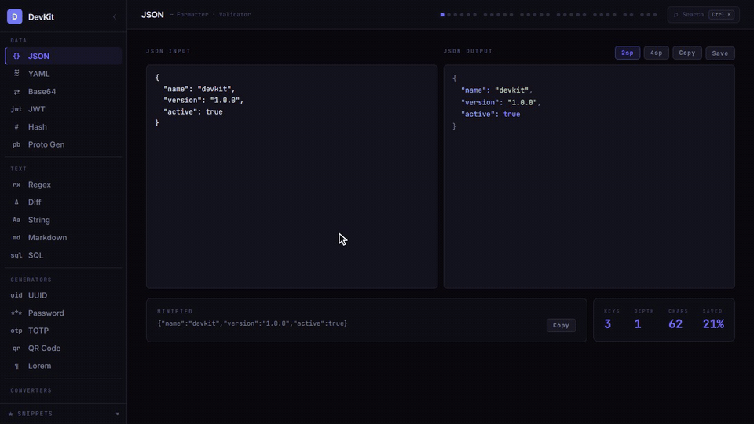
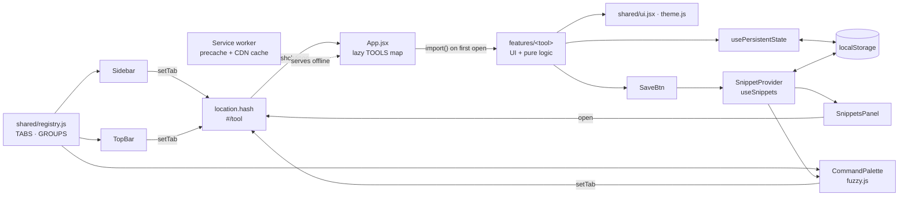
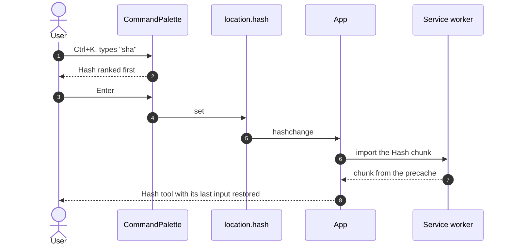
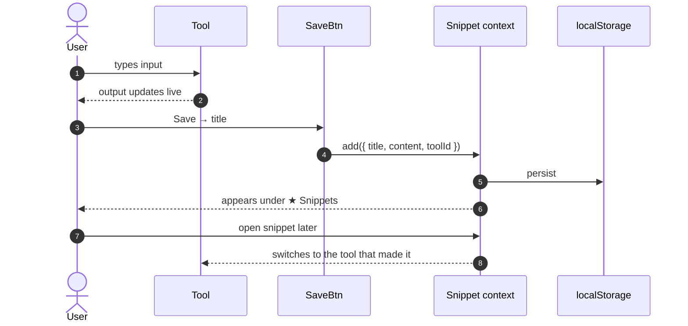

<div align="center">

# 🧰 DevKit

[](https://github.com/pero-grubac/devkit/actions/workflows/ci.yml)
[](https://github.com/pero-grubac/devkit/actions/workflows/deploy.yml)


**30 developer tools in one fast, dark page: a Ctrl+K command palette, a link for every tool, offline support and a snippet library for anything worth keeping.**

[](https://pero-grubac.github.io/devkit/)



</div>

---

## 📌 Project Overview

**DevKit** collects the small utilities developers keep searching for (JSON formatting, JWTs, hashes, regex, cron, subnets, colours…) into one single-page React app. Every tool updates as you type, remembers what you typed last time and has its own link (`#/jwt`, `#/ip`…). Press **Ctrl+K** to jump anywhere, save any output to a **snippet library**, and install it as an app that keeps working offline.

No backend, no tracking, no ads. Everything runs in the browser.

---

## ✨ Features

- ⚡ **Instant**: each tool reacts as you type
- ⌨️ **Command palette**: <kbd>Ctrl</kbd>/<kbd>⌘</kbd>+<kbd>K</kbd> (or <kbd>/</kbd>) fuzzy-searches tools by name, id and description (`sha` → Hash, `cidr` → IP / CIDR) plus your saved snippets
- 🔗 **A URL per tool**: hash routes like `#/jwt` work as bookmarks and deep links, and back/forward move between tools
- 💾 **Remembers inputs**: each tool restores its last input after a reload (secrets excluded); one palette command clears it all
- 📴 **Installable and offline**: a service worker precaches the app; js-yaml and marked are cached once YAML / Markdown have been used
- 🪶 **Code-split**: each tool is its own chunk, so the first load is about half the size it was
- 🧩 **30 tools** in 7 groups: Data, Text, Generators, Converters, Web & Network, Design, Project
- 📌 **Snippet library**: save any output with a title; search, copy, rename and reopen it from the sidebar
- 🗂️ **Feature folders**: every tool is self-contained, so adding or removing one touches two files
- 🔐 **Local crypto**: hashing, JWT signing and TOTP use the Web Crypto API; nothing is sent anywhere
- 📱 **Responsive**: on phones the sidebar starts as an icon rail, the page padding tightens and the palette fits the screen
- ♿ **Accessible palette**: a modal `dialog` with a `combobox` and `listbox`, `aria-activedescendant`, a focus trap, and focus handed back on close
- 🛡️ **Safe output**: highlighted JSON is HTML-escaped and generated `curl` commands quote embedded `'` correctly

---

## 🧰 Tools

### 📦 Data

| Tool | What it does |
|------|--------------|
| **JSON** | Format and validate, minify, syntax highlight, key count and depth |
| **YAML** | JSON ↔ YAML, Python dict → JSON/YAML (`True`/`False`/`None`) |
| **Base64** | Text encode/decode, URL-safe mode, image → Base64 with drag & drop |
| **JWT** | Decode with expiry status; sign HS256/384/512 tokens |
| **Hash** | MD5 (pure JS) and SHA-1/256/512 (Web Crypto), upper/lower hex |
| **Proto Gen** | Python / C# / Java / TypeScript classes or ORM models (SQLAlchemy, Django, Pydantic, EF, JPA, TypeORM, Prisma) → `.proto`, field builder, service scaffold |

### 📝 Text

| Tool | What it does |
|------|--------------|
| **Regex** | Live match highlighting, flags, presets, replace mode, match list |
| **Diff** | Line and character diff, unified patch output |
| **String** | 13 case conversions, word/char/sentence stats, clean-up operations |
| **Markdown** | Live preview and HTML output |
| **SQL** | Format and highlight queries, 2/4-space indent |

### 🎲 Generators

| Tool | What it does |
|------|--------------|
| **UUID** | v4, v7 and CUID, bulk, uppercase / no-dashes |
| **Password** | CSPRNG passwords with a chosen charset and live entropy |
| **TOTP** | RFC 6238 codes with a 30 s countdown, current and next code |
| **QR Code** | Pure-JS encoder, 4 error-correction levels, 4 scales, PNG download |
| **Lorem** | Paragraphs, sentences or words |

### 🔁 Converters

| Tool | What it does |
|------|--------------|
| **Number** | Bin/oct/dec/hex, random numbers, rounding |
| **IEEE 754** | 32/64-bit float layout: sign, exponent, mantissa, special values |
| **Timestamp** | Unix ↔ date, relative time, custom formats, time zones |
| **Semver** | Parse, bump (major/minor/patch/pre-release), compare |
| **Chmod** | Checkboxes ↔ octal ↔ symbolic, presets |

### 🌐 Web & Network

| Tool | What it does |
|------|--------------|
| **HTTP Request** | Build and send requests; generate `curl`, `fetch` and `axios` code |
| **HTTP Status** | Searchable 1xx–5xx reference |
| **URL** | Parse, build, encode/decode query parameters |
| **IP / CIDR** | IPv4 details and a full subnet calculator |

### 🎨 Design & 🗂️ Project

| Tool | What it does |
|------|--------------|
| **Color** | Picker with HEX / RGB / HSL / RGBA / Tailwind output |
| **Color Palette** | 10-step shades, harmonies, CSS variables or Tailwind config |
| **Commit** | Conventional Commit message builder |
| **Gitignore** | 34 templates, editable before download |
| **Cron** | Human-readable description, next runs, presets |

---

## 🛠️ Tech Stack

| Technology | Usage |
|------------|-------|
| React 19 | UI |
| Vite 8 | Dev server and bundler |
| Web Crypto API | SHA hashing, JWT signing, TOTP |
| `localStorage` | Snippet library and remembered inputs |
| `React.lazy` + `Suspense` | One chunk per tool |
| vite-plugin-pwa (Workbox) | Manifest, service worker, precache and runtime caching |
| js-yaml, marked (CDN, lazy-loaded) | YAML and Markdown, loaded on first use and cached for offline |
| ESLint 10 | Linting (React Hooks rules) |
| `node:test` | Tests for the pure logic (tools, fuzzy search, routing, persistence) |
| Playwright | End-to-end smoke tests on desktop and mobile viewports |
| Lighthouse CI | Performance, accessibility, best-practices and SEO report |
| GitHub Actions + GitHub Pages | CI and deployment |

No UI libraries, CSS frameworks, router or state-management libraries. The only runtime dependencies are React and React DOM.

---

## 📁 Project Structure

```
devkit/
├── index.html
├── vite.config.js                base: '/devkit/', PWA manifest and caching rules
├── playwright.config.js          e2e: build, preview on :4321, desktop + mobile
├── lighthouserc.json
├── eslint.config.js
├── public/                       favicon.svg, PWA icons (192, 512, maskable), apple-touch-icon
├── src/
│   ├── main.jsx
│   ├── App.jsx                   Lazy tool map, hash route, palette shortcut, layout
│   ├── index.css                 Tokens, nav, responsive rules
│   ├── components/
│   │   ├── Sidebar.jsx           Grouped navigation, collapse to icon rail
│   │   ├── TopBar.jsx            Tool title, dot navigation, palette button
│   │   ├── CommandPalette.jsx    Ctrl+K search over tools, snippets and commands
│   │   └── SnippetsPanel.jsx     Saved snippets: search, copy, open, rename, delete
│   ├── shared/
│   │   ├── registry.js           TABS and GROUPS: the single list of tools
│   │   ├── fuzzy.js              Pure fuzzy matching and ranking
│   │   ├── route.js              #/tool ↔ tool id
│   │   ├── persist.js            Remembered inputs in localStorage (size-capped)
│   │   ├── usePersistentState.js useState that survives reloads
│   │   ├── theme.js, ui.jsx      Design tokens and shared inputs/buttons/cards
│   │   ├── snippets.js           localStorage persistence
│   │   ├── useSnippets.js        Snippet context and hook
│   │   ├── SnippetContext.jsx    Provider
│   │   └── SaveBtn.jsx           "Save to snippets" popover
│   └── features/<tool>/          One folder per tool
│       ├── index.js              Single export
│       ├── <Tool>.jsx            UI
│       └── <logic>.js            Pure logic where there is any (md5, chmod, ieee754, parser…)
├── tests/
│   ├── tools.test.js             node:test suites for the tool logic
│   ├── shell.test.js             Fuzzy ranking, hash routes, input persistence
│   └── e2e/smoke.spec.js         Playwright smoke tests
├── readme_assets/demo.gif
└── .github/workflows/
    ├── ci.yml                    Unit + lint + build, e2e, Lighthouse
    └── deploy.yml                Lint, test, build and e2e, then deploy to GitHub Pages
```

---

## 📦 Installation

You need [Node.js](https://nodejs.org/) 20 or newer and npm.

```bash
git clone https://github.com/pero-grubac/devkit.git
cd devkit
npm install
```

No environment variables or tokens are needed.

---

## ▶️ Usage

```bash
npm run dev        # http://localhost:3000/devkit/
```

Pick a tool in the sidebar (or a dot in the top bar). To keep an output, click **Save** next to it, give it a title, and find it later under **★ Snippets** at the bottom of the sidebar.

### Command palette

Press <kbd>Ctrl</kbd>+<kbd>K</kbd> (<kbd>⌘</kbd>+<kbd>K</kbd> on macOS), <kbd>/</kbd> when you are not typing in a field, or the **Search** button in the top bar.

- Type any part of a tool's name, id or description: `sha`, `cidr`, `proto`, `2fa` and `rgx` all work (letters may be skipped).
- Saved snippets are searched by title, tool and content; opening one switches to the tool that made it.
- Commands: **Clear saved inputs** and **Collapse/Expand sidebar**.
- <kbd>↑</kbd> <kbd>↓</kbd> to move, <kbd>Enter</kbd> to open, <kbd>Esc</kbd> to close.

### Links to tools

Every tool has a hash route, so links work on GitHub Pages without any server rewrites:

```
https://pero-grubac.github.io/devkit/#/jwt
https://pero-grubac.github.io/devkit/#/ip
https://pero-grubac.github.io/devkit/#/http-req
```

Choosing a tool adds a history entry, so the browser's back and forward buttons move between tools. An empty or unknown hash opens JSON. The ids are the ones in `src/shared/registry.js`.

### Remembered inputs

Each tool keeps its main inputs and options in `localStorage` (`devkit:input:<tool>:<field>`), so a reload brings back where you were. Values equal to the default are not stored, and values over 100 KB are skipped. **Secrets are never stored**: the JWT secret and pasted tokens, the TOTP secret, the passwords from the Password tool and HTTP request headers stay in memory only. **Clear saved inputs** in the palette forgets everything (snippets are kept).

### Offline and install

The production build registers a service worker (vite-plugin-pwa, `autoUpdate`) scoped to `/devkit/`. It precaches the HTML, every tool chunk, the CSS and the icons, so the whole app opens offline after the first visit and updates itself when a new version is deployed. js-yaml and marked come from cdnjs and are kept by a *cache-first* rule once they have been loaded through the service worker, so YAML and Markdown keep working offline after their first use. The browser's **Install** option adds DevKit as a standalone app.

### Scripts

| Command | Description |
|---------|-------------|
| `npm run dev` | Dev server on port 3000 |
| `npm run build` | Production build to `dist/` |
| `npm run preview` | Serve the production build |
| `npm run lint` | ESLint |
| `npm test` | Unit tests (`node --test`) |
| `npm run test:e2e` | Playwright smoke tests (builds and previews the app first) |

The unit tests check MD5 against the RFC 1321 vectors, a JWT against the jwt.io example, chmod conversions, IEEE 754 categories, JSON stats and escaping, `curl` quoting, colour conversions, Python → proto3 generation, fuzzy ranking (`sha` → Hash, `cidr` → IP / CIDR), hash route parsing and the size-capped, fail-safe input storage.

The e2e suite runs every test on a desktop and a Pixel 7 viewport and fails on any console error. It covers palette search and open (keyboard, button, `/`, snippets), deep links with back/forward and the unknown-route fallback, JSON formatting and SHA-256 output, inputs surviving a reload and being cleared, the layout fitting the screen, and the app working offline once the service worker is installed.

To use a Chromium that is already installed instead of downloading one:

```bash
PW_CHROMIUM_PATH=/path/to/chrome npm run test:e2e
```

### Adding a tool

1. Add it to `TABS` and a group in `src/shared/registry.js`.
2. Create `src/features/my-tool/MyTool.jsx` and `index.js` (`export { MyTool } from "./MyTool";`).
3. Put pure logic in its own `.js` file so it can be tested.
4. Register it in the lazy `TOOLS` map in `src/App.jsx`: `"my-tool": tool(() => import("./features/my-tool"), "MyTool")`. It gets the route `#/my-tool` and a palette entry automatically.
5. Optional: `<SaveBtn content={output} toolId="my-tool" toolLabel="My Tool" />` next to the output.
6. Optional: `usePersistentState("my-tool", "input", "")` instead of `useState` for inputs worth remembering.

---

## 🏗️ Architecture



### Opening a tool from the palette



### Saving a snippet



---

## 🚀 CI/CD

| Workflow | Runs on | What it does |
|----------|---------|--------------|
| `ci.yml` | Pull requests and pushes to branches other than `main` | Three jobs: **test** (lint, unit tests, build), **e2e** (Playwright on desktop and mobile, traces uploaded on failure) and **lighthouse** (Lighthouse CI on the build served under `/devkit/`, report uploaded as an artifact) |
| `deploy.yml` | Push to `main`, or a manual run | Lint, test and build, plus the **e2e** job; the deploy of `dist/` to GitHub Pages waits for both |

Both workflows **skip documentation-only changes** (`*.md`, `readme_assets/`, `LICENSE`, `.gitignore`, `.vscode/`), cache npm downloads and cancel superseded runs.

**One-time setup:** **Settings → Pages → Build and deployment → Source** → **GitHub Actions**. The site is served at `https://pero-grubac.github.io/devkit/`.

---

## 🧭 Design Decisions

- **One registry.** `registry.js` drives the sidebar, the top bar and the groups, so a tool is listed in exactly one place.
- **Logic apart from UI.** Algorithms (MD5, IEEE 754, chmod, palettes, proto parsing, code generation) live in plain `.js` files with no React, which is what makes them testable in Node.
- **Lazy heavy libraries.** js-yaml and marked load from a CDN only when their tool is opened, keeping the first load small.
- **Code splitting per tool.** Every tool is a `React.lazy` chunk behind one `Suspense` boundary, so the entry bundle carries only React and the shell:

  | Build | JS | gzip |
  |-------|---:|-----:|
  | Before: single bundle | 424.8 kB | 121.9 kB |
  | After: entry chunk | 219.5 kB | 69.5 kB |
  | After: first view `#/json` (entry + JSON chunk and the shared modules it uses) | 229.5 kB | 73.8 kB |

  Every other tool is a 0.3–39 kB chunk. They are preloaded when the browser is idle (and precached by the service worker), and a loaded tool renders without a Suspense round-trip, so switching tools never flashes a loading state.
- **Hash routes, no router.** `useSyncExternalStore` reads the tool id from `location.hash`, so the URL is the single source of truth and GitHub Pages needs no 404 trick.
- **Pure helpers for the shell.** Fuzzy ranking, route parsing and input storage are plain modules with unit tests; the React parts stay thin.
- **Inline-style components with a shared token set** (`theme.js`), plus a small `index.css` for navigation and responsive overrides.
- **`react-hooks/set-state-in-effect` is a warning, not an error.** The remaining cases are effects that talk to something outside React (async hashing, canvas drawing, the TOTP clock) or reset editable state on purpose.

---

<div align="center">

*Everything runs in your browser. No accounts, no tracking, no ads.*

</div>
